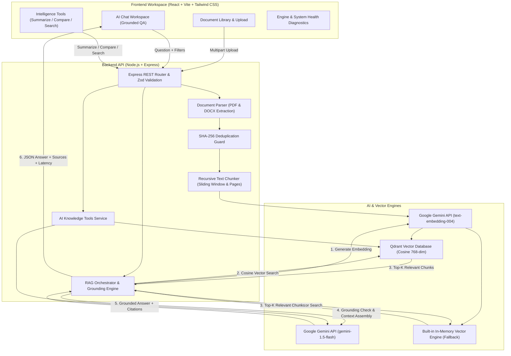

# NexusRAG — Agentic Knowledge Retrieval & Intelligence Platform

[](https://opensource.org/licenses/MIT)
[](https://nodejs.org/)
[](https://react.dev/)
[](https://ai.google.dev/)
[-red.svg)](https://qdrant.tech/)

**NexusRAG** is a portfolio-grade, full-stack Retrieval-Augmented Generation (RAG) platform. It provides document ingestion, recursive semantic chunking, 768-dimensional vector embeddings, vector similarity search, zero-hallucination grounded answer generation, and interactive source citations.

---

## Architecture Diagram



---

## Key Features

### 1. Document Ingestion & Chunking
- **Multi-Format Support:** Ingests both `.pdf` and `.docx` files with strict server-side validation.
- **Page-Aware Extraction:** Preserves page numbers and structural segments from PDF and DOCX files.
- **Natural Boundary Chunking:** Recursive sliding window chunker with configurable size and overlap that honors paragraph, sentence, and punctuation boundaries.
- **SHA-256 Deduplication:** Computes file hashes to prevent redundant ingestion and vector bloat.
- **Chunk Inspector:** Inspect extracted chunks, char counts, and page numbers directly in the UI.

### 2. High-Precision Vector Retrieval
- **Google Gemini Embeddings:** Standardized on `text-embedding-004` (768-dimensional float vectors).
- **Dual Engine Vector Store:**
  - **Qdrant Cloud & Local:** Direct integration with Qdrant via `@qdrant/js-client-rest` using Cosine distance metric.
  - **In-Memory Fallback:** High-performance built-in in-memory vector engine with exact cosine similarity and document filtering, enabling instant out-of-the-box local testing.
- **Metadata Filtering:** Query all documents or restrict searches to a specific document.
- **Configurable Thresholds:** Adjust Top-K count (1–20) and similarity score threshold (0.0–0.9).

### 3. Real Grounded RAG Pipeline
- **Zero-Hallucination Guardrails:** If retrieved context is insufficient or similarity scores do not meet the threshold, NexusRAG explicitly states that there is insufficient evidence rather than hallucinating.
- **Untrusted Input Protection:** Document contents are treated as untrusted reference material, preventing prompt injection attempts.
- **Interactive Source Citations:** Every answer returns supporting source badges displaying filename, page number, similarity match percentage, and expandable excerpt quotes.
- **Performance Diagnostics:** Logs retrieval latency (ms), LLM generation latency (ms), total latency, and token consumption.

### 4. AI Knowledge Tools
- **Deep Semantic Search Explorer:** Direct similarity testing tool returning ranked chunks with scores and highlighted extracts.
- **Document Summarizer:** Synthesizes Executive Summaries, Key Findings, and Actionable Points with section citations.
- **Multi-Document Comparator:** Select 2 or more uploaded documents and specify a focus topic to generate side-by-side comparative matrices.

---

## Technology Stack

| Layer | Technologies |
| :--- | :--- |
| **Frontend** | React 18, Vite, Tailwind CSS, Lucide Icons |
| **Backend** | Node.js (v20+), Express.js (ES Modules) |
| **Validation** | Zod (request body validation), Multer (file constraints) |
| **LLM & Embeddings** | Google Gemini (`gemini-1.5-flash`, `text-embedding-004`) via `@google/generative-ai` |
| **Vector Database** | Qdrant (`@qdrant/js-client-rest`), In-Memory Engine Fallback |
| **Document Processing**| `pdf-parse` (PDF extraction), `mammoth` (DOCX extraction) |
| **Testing** | Vitest, Supertest |

---

## Directory Structure

```text
DocuMind AI/
├── client/                      # React + Vite Frontend
│   ├── src/
│   │   ├── components/
│   │   │   ├── Chat/            # ChatWindow, MessageBubble, CitationCard
│   │   │   ├── Documents/       # DocumentLibrary, UploadModal, DocumentDetailModal
│   │   │   ├── Tools/           # KnowledgeTools (Summarizer, Compare, Search)
│   │   │   ├── Health/          # SystemHealth diagnostics & config
│   │   │   ├── Navbar.jsx       # Scope filter & quick upload
│   │   │   └── Sidebar.jsx      # Navigation & platform status
│   │   ├── services/
│   │   │   └── api.js           # REST API client
│   │   ├── App.jsx              # Main view orchestrator
│   │   ├── main.jsx             # React DOM root
│   │   └── index.css            # Tailwind directives & glassmorphic styling
│   ├── index.html
│   ├── vite.config.js           # Proxy to backend on port 5000
│   ├── tailwind.config.js
│   └── package.json
├── server/                      # Node.js + Express Backend
│   ├── src/
│   │   ├── config/              # env.js configuration & zod defaults
│   │   ├── controllers/         # documentController, chatController, toolsController, healthController
│   │   ├── middleware/          # uploadMiddleware, validator, errorHandler
│   │   ├── routes/              # documentRoutes, chatRoutes, toolsRoutes, healthRoutes
│   │   ├── services/            # documentParser, textChunker, embeddingService, vectorStore, ragPipeline, toolsService, documentStore
│   │   ├── utils/               # logger.js (sanitized logging)
│   │   ├── app.js               # Express application
│   │   └── server.js            # Server entry point
│   ├── tests/                   # Automated Vitest test suites
│   │   ├── chunker.test.js      # Text splitting & page preservation tests
│   │   ├── vectorStore.test.js  # Cosine search, filtering, and deletion tests
│   │   ├── ragPipeline.test.js  # Grounding & citation format tests
│   │   └── api.test.js          # Supertest API endpoint validation tests
│   ├── uploads/                 # Temporary upload staging
│   └── package.json
├── .env.example                 # Environment configuration template
├── .gitignore                   # Comprehensive ignores for secrets & artifacts
├── package.json                 # Monorepo scripts
└── README.md                    # Project documentation
```

---

## Getting Started

### Prerequisites
- **Node.js**: v18 or v20+ (`node -v`)
- **npm**: v9+ (`npm -v`)
- **Google Gemini API Key**: [Get a free API key from Google AI Studio](https://aistudio.google.com/app/apikey)
- **Qdrant (Optional)**: Either a free cluster on [Qdrant Cloud](https://cloud.qdrant.io) or local Docker:
  ```bash
  docker run -p 6333:6333 qdrant/qdrant
  ```
  *(Note: If Qdrant is not running, NexusRAG automatically runs on its built-in in-memory vector store)*

---

### Installation & Setup

1. **Clone the repository:**
   ```bash
   git clone https://github.com/your-username/nexusrag.git
   cd nexusrag
   ```

2. **Configure Environment Variables:**
   Copy `.env.example` to `.env`:
   ```bash
   cp .env.example .env
   ```
   Open `.env` and fill in your Gemini API key and Qdrant settings:
   ```env
   GEMINI_API_KEY=your_gemini_api_key_here
   GEMINI_CHAT_MODEL=gemini-1.5-flash
   GEMINI_EMBEDDING_MODEL=text-embedding-004
   QDRANT_URL=http://localhost:6333
   QDRANT_API_KEY=
   QDRANT_COLLECTION_NAME=nexusrag_documents
   PORT=5000
   ```

3. **Install Dependencies:**
   ```bash
   # Install root, server, and client packages
   npm run install:all
   ```

4. **Run Automated Tests:**
   ```bash
   npm test
   ```

5. **Start Development Servers:**
   - **Start Backend:**
     ```bash
     npm run dev:server
     ```
     Server will listen at `http://localhost:5000`
   - **Start Frontend:** (in a separate terminal)
     ```bash
     npm run dev:client
     ```
     Vite will open at `http://localhost:5173`

---

## API Documentation

| Method | Endpoint | Description |
| :--- | :--- | :--- |
| `GET` | `/api/health` | System status, vector counts, Gemini & Qdrant connectivity |
| `POST`| `/api/documents/upload` | Upload PDF or DOCX file (multipart/form-data) |
| `GET` | `/api/documents` | List all uploaded documents with status and metadata |
| `GET` | `/api/documents/:id` | Retrieve single document details and chunk previews |
| `DELETE`| `/api/documents/:id` | Delete document and purge vectors from Qdrant |
| `POST`| `/api/chat` | RAG query with question, document filter, history, top-K |
| `POST`| `/api/documents/:id/summarize` | Executive summary of a document (`style`: brief/detailed/bullets) |
| `POST`| `/api/documents/compare` | Cross-document comparison across 2+ documents |
| `POST`| `/api/documents/search` | Direct raw vector search with similarity scores |

---

## Security & Reliability Considerations

- **Zero Hardcoded Secrets:** All credentials are loaded exclusively through environment variables.
- **Sanitized Logging:** API keys and sensitive tokens are scrubbed from server logs.
- **Untrusted Content Isolation:** System instructions strictly segregate document context to prevent prompt injection.
- **Duplicate Prevention:** SHA-256 content hashing blocks redundant chunk ingestion.
- **Single-User Local Version:** This local development release is designed for single-user workstation execution. For multi-tenant production deployments, add JWT authentication and user ownership column checks to every endpoint.

---

## License

This project is licensed under the [MIT License](LICENSE).
